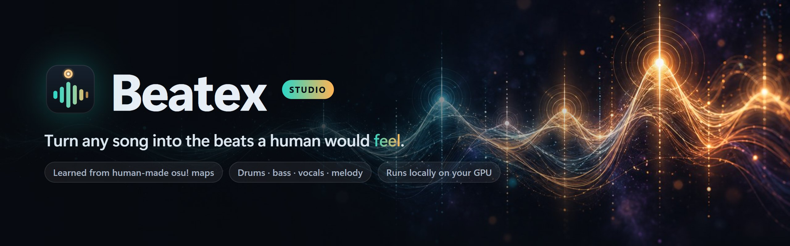
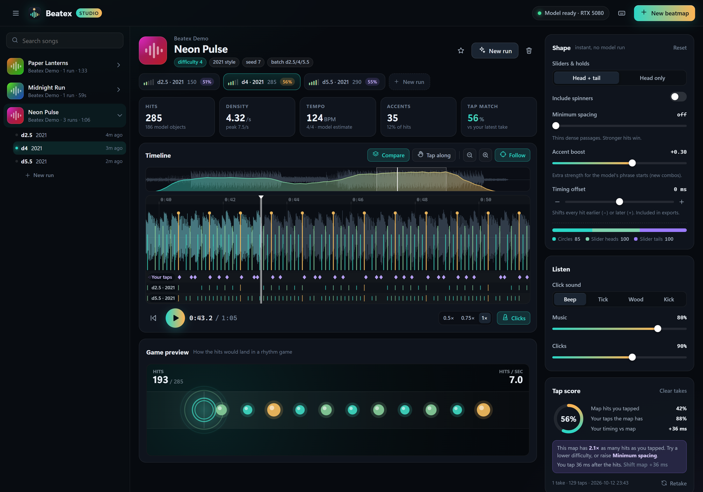
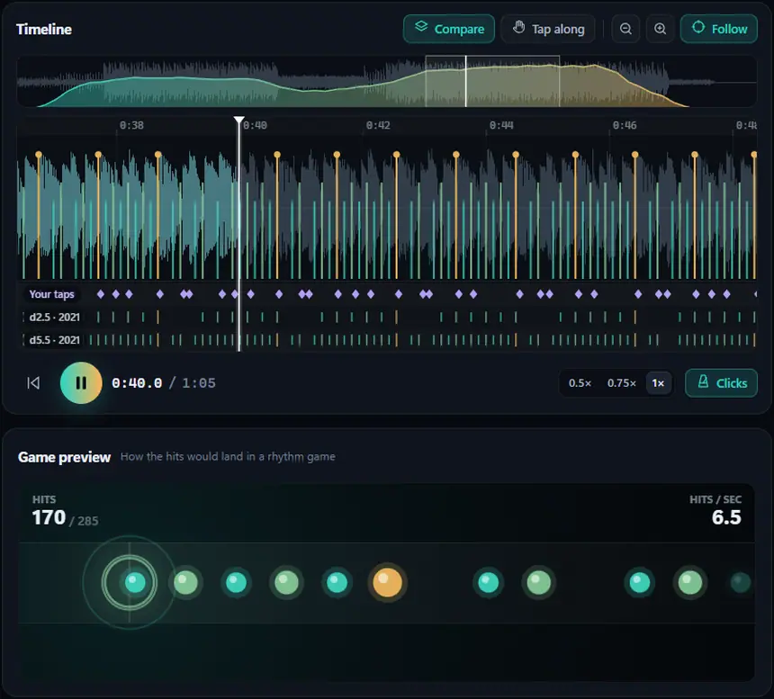
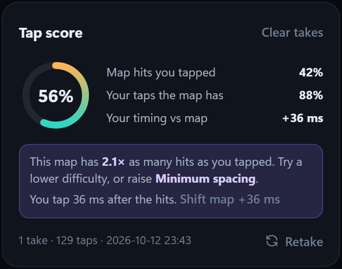
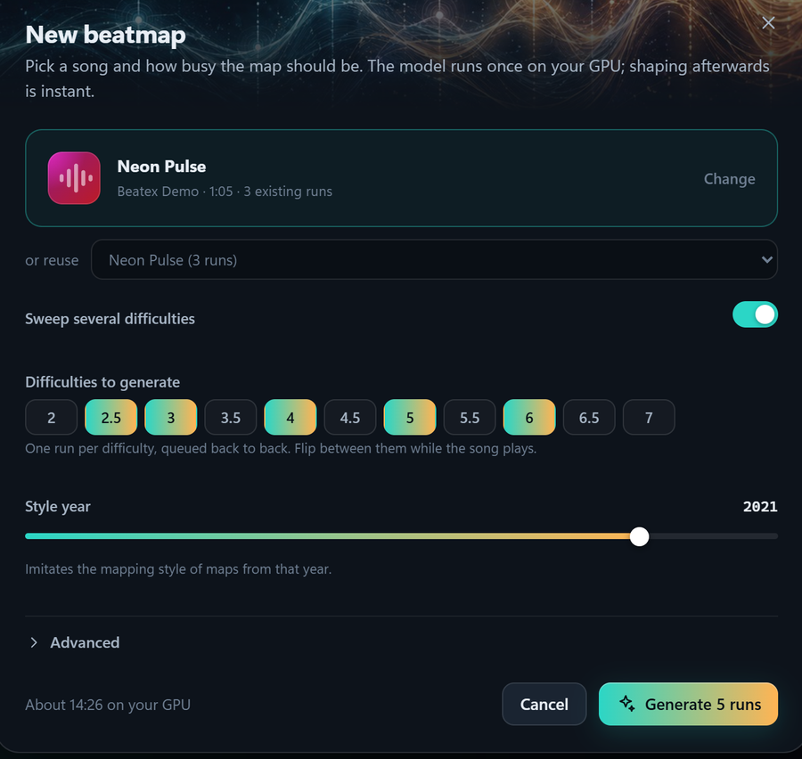
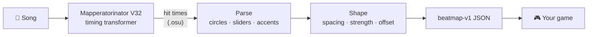

<p align="center">
  
</p>

<p align="center">
  <a href="LICENSE"></a>
  
  
  <a href="https://github.com/OliBomby/Mapperatorinator"></a>
  
</p>

<p align="center">
  <b>Beatex finds the moments in a song that a human <i>feels</i> as a hit, across drums, bass, vocals and melody,<br>
  and hands them to you as a game-ready beatmap.</b>
</p>

<p align="center">
  <a href="#quick-start">Quick start</a> ·
  <a href="#beatex-studio">Beatex Studio</a> ·
  <a href="#how-it-works">How it works</a> ·
  <a href="#use-it-in-your-game">Use it in your game</a> ·
  <a href="#roadmap">Roadmap</a>
</p>

<p align="center">
  
</p>

## Why Beatex?

Beat trackers give you the *tempo*. Onset detectors give you every *transient*. A
rhythm game needs something else: the hits a player would **feel**. That might be the
vocal line in the chorus, the synth stab, the kick that lands with the drop, or a
quiet bar where nothing should happen at all.

osu! mappers have been placing exactly those hits by hand for years. Beatex reuses
**[Mapperatorinator](https://github.com/OliBomby/Mapperatorinator)**, a model trained
on that human-made corpus, purely as a *timing* engine. It keeps the hit times and
drops everything osu-specific.

- 🎯 **Learned from humans**: hits land where people map them, not where the waveform spikes.
- 🎼 **Whole-song musical**: hits follow vocals and melody too, not just drums.
- 🎚️ **Tunable density**: pick a difficulty, then thin, accent and shift the hits instantly, with no model re-run.
- 🎮 **Game-ready**: `beatmap-v1` JSON with times and strengths that drops straight into Unity's `JsonUtility`.
- 🔒 **Local and private**: everything runs on your own GPU; nothing is uploaded.

## Beatex Studio

A desktop app for the whole loop: generate, shape, listen, compare, export. Double-click
`Beatex.bat` and it opens in its own window.

<p align="center">
  
</p>

<table>
  <tr>
    <td width="50%" valign="top">
      <h3>🎧 Feel it, live</h3>
      The song and the clicks share one audio clock, so clicks are sample-accurate.
      Change spacing, accents or offset <b>while the song plays</b>. Flip between
      difficulties mid-song and A/B them by ear. A rhythm-game preview shows how the
      hits would land.
    </td>
    <td width="50%" valign="top">
      <h3>👆 Tap along, get a score</h3>
      Tap the beats you feel. Beatex scores <b>every run</b> of the song against your
      taps (precision, recall, F1 and your timing bias), highlights the run that
      matches you best, and suggests what to change.
    </td>
  </tr>
  <tr>
    <td></td>
    <td></td>
  </tr>
  <tr>
    <td valign="top">
      <h3>🧭 See everything</h3>
      A zoomable waveform with hits coloured by strength, a hit-density overview of
      the whole song, and lanes that line up every run of the song and your taps.
    </td>
    <td valign="top">
      <h3>⚡ Generate in batches</h3>
      Drop in a song, pick a difficulty, or sweep several at once. Runs queue on the
      GPU with live progress. Close the window and they finish in the background.
    </td>
  </tr>
</table>

Exports save `beatmap-v1` JSON (for your game) or a click-track mp3 (for a sanity
listen anywhere) to `data/exports/`. Full tour: [`docs/studio.md`](docs/studio.md).

## Quick start

**You need:** Windows 10/11, an NVIDIA GPU (it falls back to the CPU, but slowly),
plus [git](https://git-scm.com), [uv](https://docs.astral.sh/uv/) and
[ffmpeg](https://ffmpeg.org):

```powershell
winget install Git.Git astral-sh.uv Gyan.FFmpeg
```

**Then:**

```powershell
git clone https://github.com/Draganoider/Beatex.git
cd Beatex
powershell -ExecutionPolicy Bypass -File scripts\setup.ps1
```

`setup.ps1` clones the model into `external/`, builds its Python 3.10 environment with
the right CUDA build of PyTorch for your driver, and builds the app environment.
It's safe to re-run. Then **double-click `Beatex.bat`**.

No song handy? `.venv\Scripts\python tools\demo_track.py` synthesizes a royalty-free
one into `data\demo\`.

The first generation downloads the model weights from Hugging Face (one time). After
that, a song takes about a minute or two of GPU time on an RTX 5080.

<details>
<summary><b>Manual setup / Linux / macOS</b></summary>

```sh
git clone --recurse-submodules https://github.com/OliBomby/Mapperatorinator.git external/Mapperatorinator
uv venv external/Mapperatorinator/.venv --python 3.10
# pick the PyTorch index for your platform: https://pytorch.org/get-started/locally/
uv pip install --python external/Mapperatorinator/.venv torch torchaudio --index-url https://download.pytorch.org/whl/cu130
uv pip install --python external/Mapperatorinator/.venv -r setup/mapperatorinator-requirements-win.txt
uv venv .venv --python 3.12
uv pip install --python .venv -e ".[app]"
python app/studio/server.py --app     # or --open for your browser
```

On Linux/macOS the venv interpreters live in `bin/` instead of `Scripts/`. Point Beatex
at them with `BEATEX_MODEL_PYTHON` if needed. The verified runbook is in
[`docs/model-setup.md`](docs/model-setup.md).
</details>

## How it works



- **Generate (once, GPU).** Mapperatorinator's transformer turns the audio into
  osu!-style hit objects. Beatex runs it in its own isolated environment and skips the
  diffusion stage that only places x/y positions.
- **Shape (instant, no model).** Circles and slider heads/tails become hits. New-combo
  starts become accents (strength), and you control slider tails, minimum spacing,
  accent boost and a global offset. Every change re-derives the map in milliseconds.
- **Use it.** You get a flat, sorted list of hit times with strengths.

## Use it in your game

```json
{
  "version": "beatmap-v1",
  "source":   { "filename": "song.mp3", "sha256": "…", "duration_sec": 96.04 },
  "analysis": { "bpm": 150.3, "meter": "4/4", "confidence": 0.8 },
  "events":   [ { "id": "evt_000001", "time_sec": 1.16, "type": "hit",
                  "strength": 0.55, "confidence": 0.75, "source": "circle", "edited": false } ],
  "sections": []
}
```

Unity, with no extra packages:

```csharp
[System.Serializable] public class BeatEvent { public string id; public float time_sec; public float strength; public string source; }
[System.Serializable] public class Beatmap   { public string version; public BeatEvent[] events; }

var map = JsonUtility.FromJson<Beatmap>(jsonText);
foreach (var e in map.events)
    SpawnNote(e.time_sec, e.strength);   // strength 0..1: bigger = more important hit
```

Prefer the terminal? The CLI does the whole pipeline in one go:

```sh
beatex extract "song.mp3" --difficulty 4 --year 2021 -o song.beatmap.json
```

## Roadmap

- [x] Timing from Mapperatorinator V32, shaped into `beatmap-v1`
- [x] Beatex Studio: live preview, run comparison, tap-along scoring, batch generation
- [ ] Personal taste: re-rank hits using your own tap takes
- [ ] Song sections (intro / verse / chorus / drop) in `sections`
- [ ] One-command setup for Linux and macOS
- [ ] Loader examples for Godot and the web

Ideas and bug reports are very welcome in [Issues](https://github.com/Draganoider/Beatex/issues).
It helps to know which engine and game you're building for.

## Contributing

PRs welcome! Good first areas: loaders for other engines, Linux/macOS setup, and
listening feedback on the default difficulty and density. The project wiki lives in
[`docs/`](docs/Home.md) (an Obsidian vault). Start with
[`architecture.md`](docs/architecture.md) and [`studio.md`](docs/studio.md).

## Acknowledgements

Beatex is **built on [Mapperatorinator](https://github.com/OliBomby/Mapperatorinator)**
(OliBomby, MIT), a model trained on the human-authored osu! beatmap corpus. Beatex
clones that project into `external/Mapperatorinator/` (it isn't vendored in this repo)
and reuses **only its timing output**, discarding everything osu-specific. Huge thanks
to OliBomby and to the osu! mapping community whose maps the model learned from.

Beatex is an independent project and is **not affiliated with or endorsed by** the
Mapperatorinator authors. As that project asks: always disclose AI-generated content
where appropriate.

## License

[MIT](LICENSE) © 2026 Yevhen Mishchenko.
The `beatmap-v1` schema is carried over from the author's earlier Beat_Extractor project.
