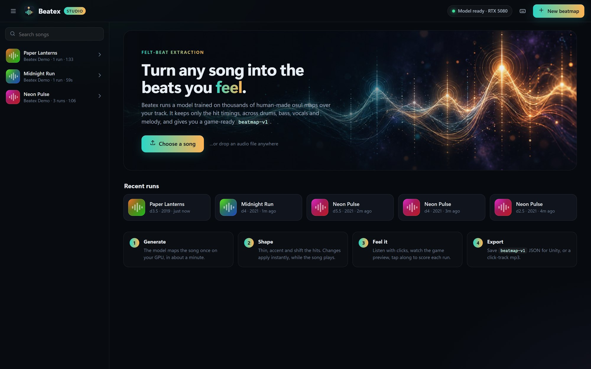

# Beatex Studio (the desktop UI)

Beatex Studio is Beatex's UI (the earlier Streamlit and PyQt UIs were removed on 2026-10-12). It's a local web app: a stdlib-only Python server (`app/studio/server.py`) plus a no-build front end (`app/studio/static/`). It wraps the same pipeline as the CLI ([[architecture]]) and keeps its run library under `data/`. Set `BEATEX_DATA_DIR` to use a different library; the README screenshots come from a demo library built with `tools/demo_track.py`.

## Launching
| How | What happens |
|---|---|
| Double-click `Beatex.bat` | Starts the server with `pythonw` (no console) and opens the Studio in its own **app window** (Edge/Chrome `--app`, separate profile in `%LOCALAPPDATA%\Beatex\studio-window`). Closing the window stops the server, but any queued or running generations finish first and are saved; reopening Beatex in the meantime reconnects to it. |
| `Beatex.exe` (`scripts/build_exe.ps1`) | The same, as a one-file PyInstaller build with the UI bundled. Keep it in the repo root so it finds `external/` and `data/`. |
| Claude desktop app | `.claude/launch.json` defines `beatex-studio`, so the Studio opens in the Code tab's browser pane. |
| `python app/studio/server.py [--open]` | Plain server on http://127.0.0.1:8765 (only binds to localhost). |

First-time setup on Windows is a single command: `scripts/setup.ps1`. It is idempotent and picks the PyTorch CUDA build from the NVIDIA driver (≥ 580 → cu130, else cu128, no GPU → cpu); `-DryRun` previews it. No song handy? `tools/demo_track.py` synthesizes a royalty-free one (presets `neon`, `midnight`, `lanterns`).

## What it does
- **Library**: runs grouped by song (content-addressed by sha256), with search, stars, notes and delete. The last run you opened reopens on launch.
- **Generation queue**: upload (or drag and drop) a song, pick difficulty and style year, or sweep several difficulties. Jobs run **one at a time** on the GPU. Progress is parsed from the model's two tqdm passes ("Generating timing" is about 20% of the time, "Generating map" the rest), and you can cancel a job, which kills the process tree. On an RTX 5080 a run takes about 20 s to start plus roughly 0.8–1.4 s per second of audio; the time estimate learns your GPU's speed. Open the log at any time.
- **Timeline**: a full-song overview (waveform + hit-density curve + viewport) and a zoomable detail view (strength-coloured markers, ruler, hover readout). Optional **lanes** show the other runs of the song and your tap takes. Wheel zooms, drag pans, a click seeks, and *Follow* keeps the playhead in view.
- **Live listening**: song and clicks share **one Web Audio clock**, so clicks are sample-accurate at any speed. Shaping changes apply while the song plays. Click sounds are beep/tick/wood/kick; you can set music and click volumes, play at 0.5×/0.75×/1×, and flip between runs mid-song without losing your place.
- **Game preview**: a rhythm-game highway (hits fly into a hit ring and pulse with strength) plus a spectrum skyline, to check the feel.
- **Tap along**: tap D/F/J/K (or click the game view) on the beats you feel, with clicks muted. Takes are saved per song in `data/runs/taps/<sha>.json`. Each run of the song is then **scored** against your latest take. Your constant timing bias is estimated first (median nearest-hit offset), then taps and hits are matched one-to-one within ±60 ms. The score reports precision ("map hits you tapped"), recall ("your taps the map has"), F1 and your bias. The best run is highlighted, and you get advice on difficulty or minimum spacing, plus a one-click offset fix.
- **Export**: `beatmap-v1` JSON and a click-track mp3, both with the current shaping and volumes. They go to `data/exports/` with a *Show in folder* button. You can also copy the JSON to the clipboard.

## Server API (all JSON, under `/api`)
`health` · `runs` (GET list, `runs/<id>` GET/PATCH star+note/DELETE) · `runs/<id>/events?policy&spinners&min_spacing&accent&offset` (instant shaping) · `runs/<id>/beatmap.json`, `runs/<id>/clicktrack.mp3` (downloads) · `runs/<id>/export` (save to `data/exports`) · `reveal` · `upload` (raw body, `X-Filename` header; stored by sha256) · `audio/<sha><ext>` · `songs/<sha>/taps` (GET/POST/DELETE) · `jobs` (GET/POST; `combos` = batch) · `jobs/<id>` (GET with log / DELETE = cancel) · `jobs/clear` · `bye` (app-window close beacon).

The server reads every non-upload request body before routing, so a body is never left on a keep-alive connection. One left over (from the `bye` beacon) once corrupted the next request.

## Front-end modules (`app/studio/static/js/`)
`main.js` (state + wiring) · `audio.js` (engine: lookahead click scheduler driven by a Worker tick so it survives background throttling, latency-compensated position via `getOutputTimestamp`) · `timeline.js` (peak pyramid + canvases) · `game.js` · `taps.js` (scoring) · `api.js` · `ui.js` (icons, toasts, modals). Prefs (shape, volumes, toggles) persist in `localStorage`. `window.beatex` exposes state for console debugging.

## Assets
`assets/logo.svg` (the mark) is rendered to `icon-256/512.png` and `beatex.ico` with QtSvg. `assets/hero.jpg` is the welcome-screen artwork, generated with Codex image gen to match the teal→amber "hit strength" palette.

Related: [[architecture]], [[model-setup]], [[decisions]].
